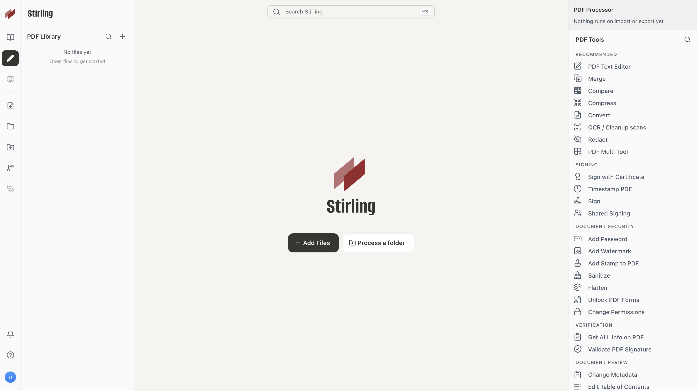

<p align="center">
  
</p>

<h1 align="center">RedPDF - 开源 PDF 平台</h1>

RedPDF 是一个本地 PDF 工具，合并了编辑、转换、OCR、签名、压缩等常用功能，直接跑在浏览器或桌面端，不用把文件传去任何在线服务。

_An open-source PDF toolkit — runs locally in your browser or desktop, no uploads required._

<p align="center">
  <a href="https://hub.docker.com/r/redpdf/redpdf">
    
  </a>
  <a href="https://discord.gg/HYmhKj45pU">
    
  </a>
  <a href="https://scorecard.dev/viewer/?uri=github.com/RedPDF/RedPDF">
    
  </a>
  <a href="https://github.com/RedPDF/redpdf">
    
  </a>
</p>



## ✨ 能做什么

- 合并、拆分、旋转、压缩 PDF
- PDF 转 Word / Excel / PPT / 图片 / 文本，也支持反向转换
- OCR 文字识别
- 添加水印、页码、签名
- 加密、解密、涂黑
- 支持批量处理，大文件也能跑

---

## 🚀 为什么做这个

PDF 工具网上很多，但要么要上传文件，要么功能零散。RedPDF 想做一个本地能跑、功能集中、不用注册登录的替代品。基于 [Stirling-PDF](https://github.com/Stirling-Tools/Stirling-PDF) 二次开发，感谢原项目的优秀基础。

---

## ⌨️ 快速开始

```bash
docker run -p 8080:8080 docker.stirlingpdf.com/redpdf/redpdf
```

浏览器打开 http://localhost:8080 就能用。

桌面版和 Kubernetes 部署方式见 [Developer Guide](docs/developer/DeveloperGuide.md)。

---

## 📋 资源与支持

- [**文档**](https://docs.stirlingpdf.com)
- [**原项目 Stirling-PDF**](https://github.com/Stirling-Tools/Stirling-PDF) — RedPDF 基于此 fork
- **问题反馈**：[GitHub Issues](https://github.com/RedPDF/RedPDF/issues)

- **Community**: [Discord](https://discord.gg/HYmhKj45pU)
- **Bug Reports**: [GitHub Issues](https://github.com/RedPDF/RedPDF/issues)

参与贡献请先读 [CONTRIBUTING.md](.github/CONTRIBUTING.md)。运行 `task dev` 启动开发环境，`task --list` 查看所有命令。

---

构建者：小宋 & Red

欢迎参与贡献！请参阅 [CONTRIBUTING.md](.github/CONTRIBUTING.md)。本项目使用 [Task](https://taskfile.dev/) 统一管理构建、开发与测试命令，运行 `task dev` 即可启动编辑器，运行 `task` 查看常用命令，详见 [Developer Guide](docs/developer/DeveloperGuide.md)。

新增翻译语言请参阅 [Translation Guide](docs/developer/HowToAddNewLanguage.md)。

## License

RedPDF 是 open-core 项目。详情请参阅 [LICENSE](LICENSE)。
